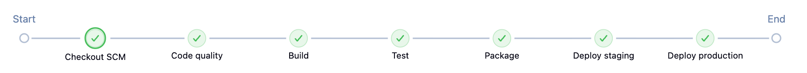
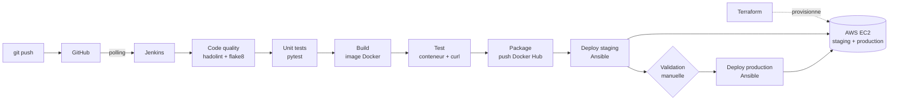
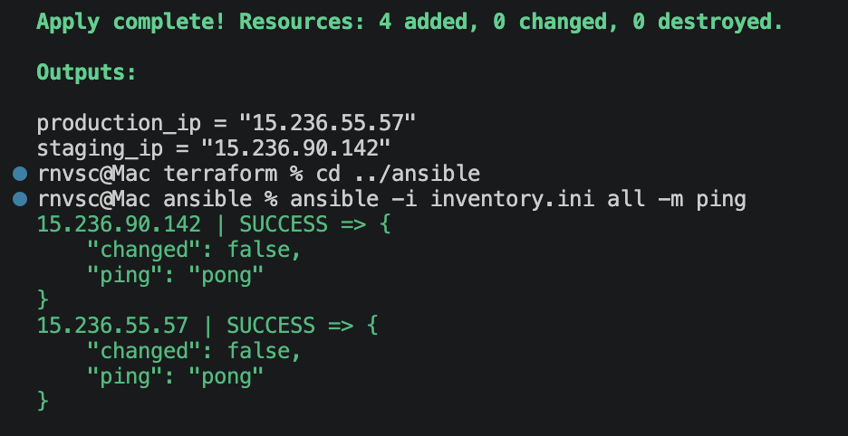

# Pipeline CI/CD Jenkins — Flask sur AWS

Pipeline CI/CD complet pour une application Python Flask : contrôle qualité, build et test de l'image Docker, publication sur Docker Hub, puis déploiement automatisé sur deux environnements AWS (staging et production) avec Ansible. L'infrastructure est provisionnée avec Terraform.



## Architecture



## Stack

| Outil | Rôle |
|---|---|
| **Flask + Gunicorn** | Application web et serveur de production |
| **Docker** | Conteneurisation (image `python:3.14-slim`, utilisateur non-root) |
| **Jenkins** | Orchestration du pipeline, déclenché automatiquement à chaque push |
| **hadolint / flake8** | Contrôle qualité du Dockerfile et du code Python |
| **pytest** | Tests unitaires de l'application |
| **Docker Hub** | Registre d'images |
| **Terraform** | Provisionnement de l'infrastructure AWS |
| **Ansible** | Configuration des serveurs et déploiement de l'application |
| **AWS EC2** | Environnements staging et production (Ubuntu 24.04, ARM) |

## Les étapes du pipeline

| Étape | Ce qu'elle fait |
|---|---|
| **Code quality** | Vérifie le Dockerfile (hadolint) et le code Python (flake8). Placée en premier pour échouer vite si le code ne respecte pas les règles |
| **Unit tests** | Teste le code avec pytest : les routes `/` et `/health`, et le gestionnaire d'erreurs, qui ne doit pas exposer le message interne |
| **Build** | Construit l'image, taguée avec le numéro de build (`v$BUILD_NUMBER`) |
| **Test** | Test de fumée : lance un conteneur à partir de l'image et vérifie que `/` et `/health` répondent. Le conteneur est supprimé même en cas d'échec (`post { always }`) |
| **Package** | Publie l'image sur Docker Hub. Le token est stocké dans les credentials Jenkins et masqué dans les logs |
| **Deploy staging** | Déploie l'image sur le serveur staging avec Ansible, puis vérifie `/health` |
| **Deploy production** | Après **validation manuelle**, déploie la même image sur la production, puis vérifie `/health` |

## Structure du projet

```
.
├── main.py              # Application Flask (routes /, /health et /error)
├── gunicorn.conf.py     # Configuration du serveur Gunicorn
├── requirements.txt     # Dépendances de l'application
├── requirements-dev.txt # Outils de test et de qualité (pytest, flake8)
├── pytest.ini
├── .flake8
├── tests/
│   └── test_main.py     # Tests unitaires
├── Dockerfile
├── .dockerignore
├── Jenkinsfile
├── terraform/
│   └── main.tf          # Clé SSH, security group, 2 instances EC2
└── ansible/
    ├── inventory.ini    # Serveurs staging et production
    └── deploy.yml       # Installe Docker et lance le conteneur
```

## Choix techniques

- **Image légère et sécurisée** : base `slim`, dépendances installées avant le code pour profiter du cache Docker, application lancée avec un utilisateur non-root (UID 1000). Le Dockerfile passe hadolint sans aucune remarque.
- **Image minimale** : le `.dockerignore` exclut tout ce qui ne sert pas à faire tourner l'application (tests, outils de développement, Terraform, Ansible, documentation). Seuls `main.py`, `gunicorn.conf.py` et `requirements.txt` entrent dans l'image.
- **Deux niveaux de test** : les tests unitaires vérifient le code avant le build, le test de fumée vérifie que l'image construite démarre et répond.
- **Un seul playbook pour deux environnements** : le playbook cible `hosts: all`, et Jenkins choisit l'environnement avec `--limit`. La version de l'image (`image_tag`) et l'environnement (`app_env`) sont passés en variables.
- **Playbook idempotent** : relancé sans changement, il ne modifie rien (`changed=0`). Les tags d'image étant uniques à chaque build, l'option `pull: true` a été retirée : elle provoquait une recréation inutile du conteneur.
- **Validation manuelle avant la production** : le pipeline se met en pause après le staging et attend une approbation (`input`), tracée dans les logs.
- **Secrets hors du code** : token Docker Hub et clé SSH stockés dans les credentials Jenkins. La clé SSH est dédiée au projet et n'est jamais versionnée.
- **Accès SSH restreint** : le security group n'ouvre le port 22 qu'à une seule adresse IP. Le port 80 est ouvert à tous.
- **Instances ARM (`t4g.micro`)** : même architecture que la machine de build, l'image tourne directement sans build multi-architecture.

## Lancer en local

```bash
# Contrôle qualité et tests unitaires
docker run --rm -v "$PWD":/src -w /src python:3.14-slim \
  sh -c "pip install -q -r requirements-dev.txt && flake8 . && pytest -v"

# Construire et lancer l'application
docker build -t flask-app .
docker run -d --name flask-app -p 8083:8080 flask-app
curl http://localhost:8083          # Hello World
curl http://localhost:8083/health   # {"env":"dev","status":"ok"}
```

## Déployer sur AWS

### Prérequis

- Docker, Terraform, Ansible et la CLI AWS (configurée)
- Un Jenkins avec accès à Docker et Ansible installé
- Une paire de clés SSH dédiée : `ssh-keygen -t ed25519 -f ~/.ssh/flask-cicd`

### 1. Créer l'infrastructure

Mettre son adresse IP publique dans la règle SSH de `terraform/main.tf`, puis :

```bash
cd terraform
terraform init
terraform apply
```

Les adresses IP des serveurs s'affichent à la fin. Les reporter dans `ansible/inventory.ini` et dans le bloc `environment` du `Jenkinsfile`.




### 2. Configurer Jenkins

Credentials à créer :

| ID | Type | Contenu |
|---|---|---|
| `dockerhub-credentials` | Username with password | Utilisateur Docker Hub + access token |
| `aws-ssh-key` | SSH Username with private key | Utilisateur `ubuntu` + clé privée dédiée |

Créer un job **Pipeline** de type *Pipeline script from SCM* pointant vers ce dépôt. Le pipeline se déclenche ensuite automatiquement à chaque push.

### 3. Déployer à la main (optionnel)

```bash
cd ansible
ansible-playbook -i inventory.ini deploy.yml --limit staging -e "image_tag=v19 app_env=staging"
curl http://<IP_STAGING>/health
```

### 4. Tout supprimer

```bash
cd terraform
terraform destroy
```

## Ce que j'ai appris

- Écrire un **Dockerfile** et un **Jenkinsfile** à partir d'une page blanche, en comprenant chaque instruction
- Concevoir un pipeline selon le principe **fail fast**, et vérifier qu'il **échoue** vraiment quand l'application est cassée
- Distinguer **tests unitaires** et **test de fumée**, et séparer ce qui va sur GitHub (`.gitignore`) de ce qui entre dans l'image (`.dockerignore`)
- Gérer les **secrets** dans Jenkins sans jamais les exposer dans le code ni dans les logs
- Faire fonctionner un Jenkins conteneurisé avec le Docker de l'hôte (`docker.sock`, `--volumes-from`, `host.docker.internal`)
- Écrire un **playbook Ansible idempotent** et diagnostiquer un `changed` inattendu
- Diagnostiquer un **`Connection timed out`** en SSH : un problème réseau (security group), pas de configuration Ansible

## Améliorations possibles

- Taguer les images avec l'identifiant du commit Git plutôt que le numéro de build
- Détecter automatiquement l'IP autorisée en SSH et générer l'inventaire Ansible depuis Terraform
- Faire tourner Jenkins dans AWS, avec une IP fixe
- Créer un VPC dédié avec subnets publics et privés
- Ajouter un scan de sécurité de l'image (Trivy)


## Crédits

Application basée sur [docker-demo-with-simple-python-app](https://github.com/bennzhang/docker-demo-with-simple-python-app) de bennzhang, modernisée (Python 2.7 → 3.14, Gunicorn configuré, route `/health`).